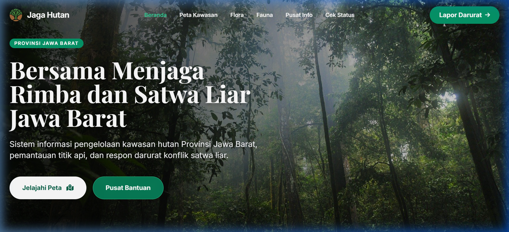
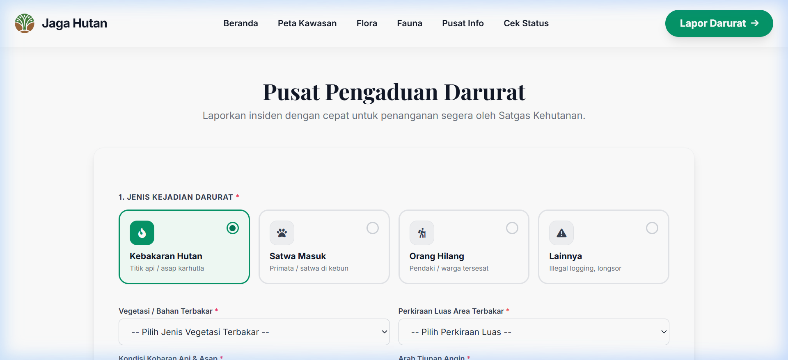
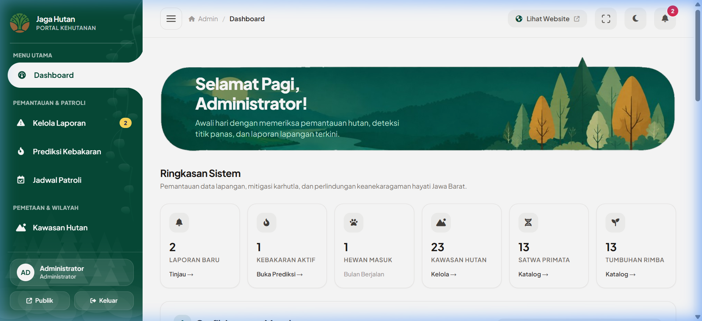
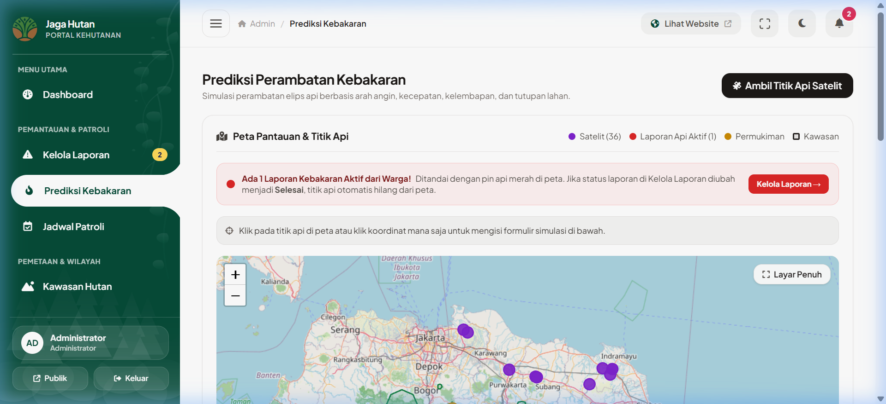
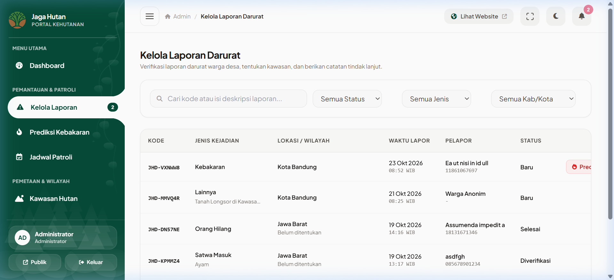

<div align="center">

# 🌲 JAGA HUTAN JAWA BARAT
### Sistem Informasi Geografis & Tanggap Darurat Konservasi Hutan Jawa Barat

[](https://laravel.com)
[](https://php.net)
[](https://livewire.laravel.com)
[](https://tailwindcss.com)
[](https://leafletjs.com)

<p align="center">
  <b>Portal digital terpadu untuk pemantauan kawasan hutan lindung, respon cepat kebakaran lahan dan konflik satwa, simulasi perambatan api berbasis satelit & cuaca, serta katalog konservasi flora & fauna endemik Jawa Barat.</b>
</p>

---

</div>

## 📌 Tentang Proyek

**Jaga Hutan Jawa Barat** dikembangkan sebagai platform kesiapsiagaan dan transparansi pengelolaan kehutanan di wilayah Provinsi Jawa Barat. Sistem ini menghubungkan masyarakat, pengelola kawasan, serta aparat terkait dalam satu ekosistem tanggap darurat yang terintegrasi secara spasial (GIS).

Aplikasi ini mencakup:
1. **Portal Publik**: Eksplorasi batas kawasan taman nasional, cagar alam, dan taman wisata alam; edukasi keanekaragaman hayati (primata & tumbuhan dilindungi); panduan keselamatan; serta pengaduan insiden lapangan secara cepat.
2. **Integrasi Satelit & Kebakaran**: Sinkronisasi titik panas (*hotspot*) aktif dari satelit NASA FIRMS (VIIRS) dan laporan langsung masyarakat ke dalam peta pemantauan.
3. **Simulasi Prediksi Perambatan Api**: Perhitungan model elips penyebaran api kebakaran berdasarkan arah angin, kecepatan angin, kelembapan udara, dan vegetasi lahan.
4. **Dashboard Administrator Terpusat**: Manajemen status laporan darurat, basis data kawasan, titik penting (pos jaga & mata air), artikel edukasi, serta kontak darurat lintas instansi.

---

## 📸 Tangkapan Layar Halaman Utama

### 1. Halaman Publik & Peta Interaktif Konservasi
Portal utama dengan peta wilayah Jawa Barat, batas kawasan hutan, status insiden aktif, galeri satwa/tumbuhan dilindungi, serta artikel edukasi.



---

### 2. Form Lapor Darurat Publik
Fasilitas pelaporan cepat untuk warga jika menemukan kebakaran hutan, konflik satwa liar, atau pendaki hilang, dilengkapi penentu titik koordinat GPS di peta serta unggah foto bukti.



---

### 3. Dashboard Administrator
Ringkasan statistik data kawasan konservasi, sebaran flora/fauna, tren laporan bulanan, dan monitoring insiden terkini.



---

### 4. Prediksi & Simulasi Perambatan Kebakaran Hutan
Fitur analisis spasial perambatan api secara elips, visualisasi titik api aktif dari laporan warga, dan sinkronisasi data satelit cuaca & titik panas.



---

### 5. Manajemen Kelola Laporan Masuk
Panel verifikasi, penugasan regu penanganan, dan pembaruan status laporan (Baru &rarr; Diverifikasi &rarr; Ditangani &rarr; Selesai).



---

## ✨ Fitur-Fitur Utama

- 🗺️ **Peta Interaktif Spasial (Leaflet GIS)**
  - Menampilkan poligon kawasan hutan lindung, taman nasional, dan cagar alam di Jawa Barat.
  - Penanda titik penting: Pos Jaga, Sumber Mata Air, Fasilitas Wisata, dan Jalur Evakuasi.
  - Filter interaktif berdasarkan kategori kawasan dan kabupaten/kota.

- 🔥 **Deteksi Titik Api & Simulasi Perambatan Api**
  - **Sinkronisasi Satelit**: Pengambilan data titik api satelit NASA FIRMS VIIRS terkini.
  - **Integrasi Laporan Aktif**: Laporan kebakaran dari warga otomatis muncul sebagai titik api beranimasi dan hilang saat penanganan dinyatakan `Selesai`.
  - **Model Perambatan Elips**: Simulasi area rambatan api 1 jam, 2 jam, dan 3 jam ke depan dengan kalkulasi arah & kecepatan angin serta tutupan vegetasi.

- 🚨 **Sistem Pengaduan & Lapor Cepat Warga**
  - Kategori insiden: Kebakaran Hutan & Lahan, Hewan Masuk Permukiman, dan Orang Hilang / Pendaki Tersesat.
  - Deteksi lokasi otomatis (*Geolocation*) atau penentuan titik manual pada peta.
  - Pelacakan status tindak lanjut laporan menggunakan Kode Tiket unik.
  - Validasi ketat kontak nomor telepon/WhatsApp hanya angka dan penyorotan otomatis field form yang belum terisi.

- 🐒 **Ensiklopedia Hayati (Flora & Fauna Endemik)**
  - Katalog primata dilindungi Jawa Barat (Owa Jawa, Surili, Lutung, Kukang Jawa).
  - Katalog tumbuhan langka & endemik beserta status konservasi (IUCN).
  - Tampilan gambar dengan penanganan *fallback* terproteksi agar tidak terjadi gambar rusak/pecah.

- ⚙️ **Panel Manajemen Admin Responsif**
  - Autentikasi aman berbasis sesi.
  - Filter pencarian instan Livewire tanpa *reload* halaman.
  - Manajemen akun staf, pengaturan batas koordinat peta Jawa Barat, dan kontak darurat daerah.

---

## 🛠️ Teknologi yang Digunakan

| Kategori | Teknologi |
|---|---|
| **Framework Backend** | [Laravel 12](https://laravel.com) (PHP 8.2+) |
| **Komponen Reaktif** | [Laravel Livewire 3](https://livewire.laravel.com) & [Alpine.js](https://alpinejs.dev) |
| **Styling & Tampilan** | [Tailwind CSS 3](https://tailwindcss.com) & [FontAwesome 6](https://fontawesome.com) |
| **Pemetaan & GIS** | [Leaflet.js](https://leafletjs.com) |
| **Database** | SQLite (Default Dev) / MySQL / PostgreSQL |
| **Sumber Data Spasial** | NASA FIRMS (Fire Information for Resource Management System) VIIRS |

---

## 🚀 Panduan Instalasi Lokal

Ikuti langkah-langkah berikut untuk menjalankan proyek di lingkungan pengembangan lokal:

### 1. Prasyarat Sistem
- PHP >= 8.2 (dengan ekstensi `pdo_sqlite`, `curl`, `mbstring`, `fileinfo`)
- Composer >= 2.x
- Node.js >= 18.x & NPM

### 2. Kloning Repository
```bash
git clone https://github.com/Kalzz76/Web-Pemerintahan-Kehutanan.git
cd Web-Pemerintahan-Kehutanan
```

### 3. Instal Dependensi PHP & JavaScript
```bash
composer install
npm install
```

### 4. Konfigurasi File Lingkungan (.env)
Salin file `.env.example` menjadi `.env`:
```bash
cp .env.example .env
```
Buat berkas database SQLite (jika menggunakan default SQLite):
```bash
# Windows PowerShell
New-Item -ItemType File -Path database\database.sqlite -Force

# Linux / macOS
touch database/database.sqlite
```

### 5. Generate Application Key & Storage Link
```bash
php artisan key:generate
php artisan storage:link
```

### 6. Migrasi Database & Seeder
Jalankan migrasi untuk mengisi data awal kawasan, primata, tumbuhan, titik penting, dan akun admin:
```bash
php artisan migrate --seed
```

### 7. Jalankan Server Pengembangan
Buka dua terminal terpisah:

**Terminal 1 (Laravel Dev Server):**
```bash
php artisan serve
```

**Terminal 2 (Vite Asset Bundler):**
```bash
npm run dev
```

Aplikasi dapat diakses melalui browser di alamat:  
👉 **`http://127.0.0.1:8000`**

---

## 🔐 Akun Default Administrator

Untuk mengakses modul admin di `http://127.0.0.1:8000/login`:

- **Username**: `admin`
- **Password**: `admin123`

---

## 📁 Struktur Direktori Penting

```plaintext
Web-Pemerintahan-Kehutanan/
├── app/
│   ├── Http/Controllers/       # Controller Publik, Admin, Prediksi, Lapor
│   ├── Livewire/Admin/          # Komponen tabel interaktif Livewire
│   └── Models/                  # Model Eloquent (Kawasan, TitikApi, Laporan, dll)
├── database/
│   ├── migrations/              # Skema tabel database spasial & relasional
│   └── seeders/                 # Data inisialisasi kawasan & keanekaragaman hayati
├── docs/
│   └── screenshots/             # Dokumentasi visual antarmuka aplikasi
├── public/
│   └── assets/                  # Aset gambar publik & pendukung
├── resources/
│   ├── css/ & js/               # Sumber asset Tailwind & script
│   └── views/                   # Template Blade (layouts, admin, publik)
└── routes/
    └── web.php                  # Rute aplikasi web
```

---

## 📄 Lisensi

Proyek ini dikembangkan untuk kebutuhan tata kelola kehutanan dan konservasi lingkungan hidup. Hak cipta dilindungi di bawah lisensi terbuka [MIT License](LICENSE).
